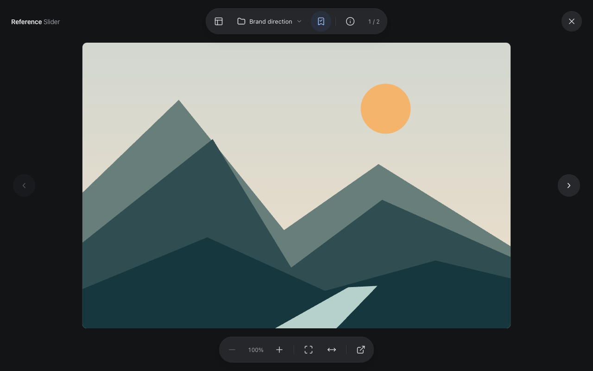
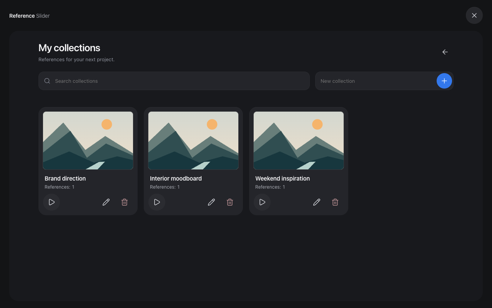

<p align="center"></p>
<h1 align="center">Pinterest Slider</h1>
<p align="center">A focused Pinterest image viewer with local project collections.</p>



Works only on supported Pinterest websites in Chrome. It does not add a viewer to other websites or run inside the Pinterest mobile app. Saved collections can be opened from the extension itself.

Browse references without repeatedly opening and closing pins. Zoom into small details, read long images, and save useful pins into collections for a project.

## Features

- Open from a Pinterest feed, search, board or an already open pin.
- Navigate with arrow keys, mouse swipes and touch gestures.
- Zoom with pinch gestures, Ctrl + wheel, double-click or toolbar buttons.
- Pan enlarged images; use **Fit to width** for long screenshots and infographics.
- Create, search, rename and revisit local reference collections.
- View descriptions, image dimensions and external source links when available.
- Original-image requests with fallback to available Pinterest resolutions.
- Circular Lucide controls, keyboard focus and reduced-motion support.

## Install locally

1. Download or clone this repository.
2. Open `chrome://extensions` and enable **Developer mode**.
3. Choose **Load unpacked** and select the `extension` folder.
4. Open or reload Pinterest, then click **Open Slider**.

After changing extension files, reload the extension using its circular reload button, then reload the Pinterest tab.

## Controls

| Action | Control |
| --- | --- |
| Next / previous image | Arrow keys, side buttons or swipe while fitted |
| Zoom | Pinch, Ctrl + wheel, double-click or − / + |
| Pan | Drag with mouse or one finger; wheel while zoomed |
| Fit image / fit width | Bottom toolbar |
| Save a reference | Choose a collection, then click the bookmark |
| Collections / image details | Top toolbar |
| Close panel / viewer | Escape |

Hover over icons for labels. The collection menu supports Arrow Up/Down, Home/End, Enter and Escape.

## Collections and privacy

Collections live in `chrome.storage.local` in your Chrome profile. Saved metadata persists across browser restarts, but does not sync between devices. Images load from Pinterest and are not stored offline. Removing the extension removes its local data.

There is no analytics service or developer-hosted backend. See the [privacy policy](store/privacy.html) for page access, storage and network details.



## Development

No build step or dependencies are needed to load the extension itself. Development scripts use Node.js 22+:

```sh
npm install
npm run check
npm test
npm run build
npm run screenshots
```

Tests use installed Google Chrome by default. To use Playwright Chromium:

```sh
npx playwright install chromium
SLIDER_BROWSER_CHANNEL=chromium npm test
```

The build generates PNG icons and a ZIP in `dist/`, with `manifest.json` at the ZIP root. Store screenshot generation renders the real interface with original demo artwork and mocked pin/storage data.

## Publication status

Version 1.2.0 is prepared for local testing and submission preparation. It has not been submitted to the Chrome Web Store. See [publication instructions](store/PUBLISHING.txt) and [listing copy](store/listing.txt). Live Pinterest and installed-extension checks are still required before submitting; automated tests use controlled fixtures.

Supported Pinterest domains: .com, .ru, .co.uk, .de, .fr, .ca, .it, .es, .com.au and .jp. Videos show an available image cover; video playback is not supported. Pinterest markup changes may affect extraction. Original resolution and source metadata are not available for every pin.

## Attribution

Independent project; not affiliated with or endorsed by Pinterest. Icons are from [Lucide](https://lucide.dev/) under its [ISC license](extension/LUCIDE-LICENSE.txt). Branding and demo artwork are original SVG assets. Project source code is released under the [MIT License](LICENSE).
